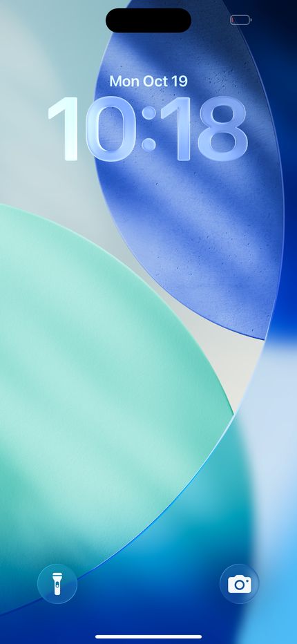
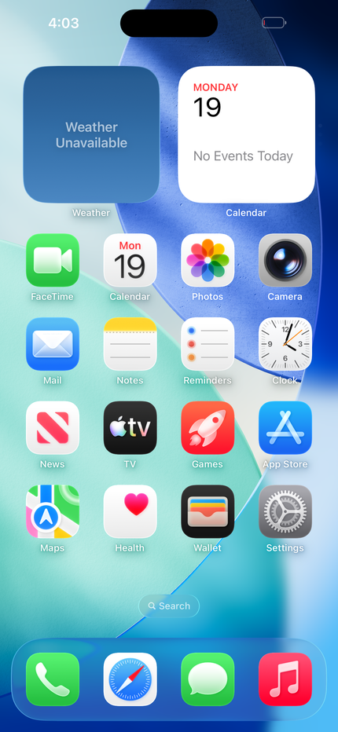
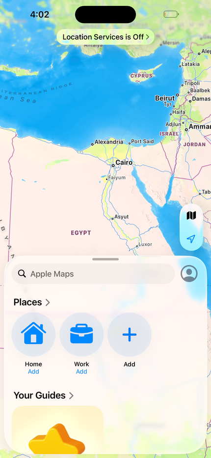
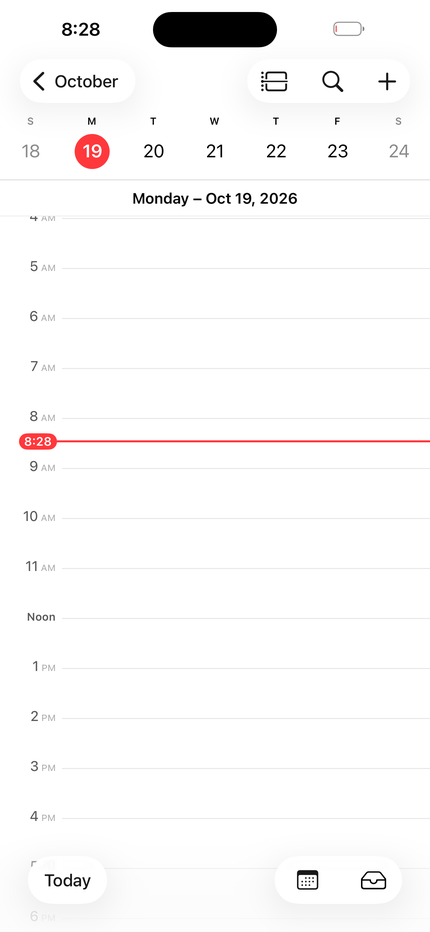

# vphone-linux

Run [vphone-cli](https://github.com/Lakr233/vphone-cli)'s virtual iPhone on a **Linux x86_64 host**.

<p align="center">
  
  
  
  
</p>
<p align="center"><i>iOS 26.6.2 running on a Linux PC (Fedora, NVIDIA GPU) in vphone-linux.</i></p>

vphone-cli runs iOS on an Apple Silicon Mac with Apple's Virtualization.framework, on the
`vresearch101` virtual platform that Apple's Private Cloud Compute (PCC) research VMs use. vphone-linux
boots the **same VM bundle** on Linux, with no Mac and no Apple code at run time:

- **QEMU** (a fork of [ChefKissInc/QEMUAppleSilicon](https://github.com/ChefKissInc/QEMUAppleSilicon)) gains a
  `-M vresearch101` machine and an `apple-gxf` CPU (GXF/SPRR for SPTM and TXM). It runs the guest
  under TCG with 8 vCPUs and models the SEP coprocessor, the GIC wiring, a USB touchscreen, vsock and
  the paravirtual GPU's MMIO device.
- **[reims-vgpu](https://github.com/steelbrain/reims-vgpu)** implements Apple's ParavirtualizedGraphics
  protocol on the host. It is statically linked into QEMU.
- **[metal2vulkan](https://github.com/steelbrain/metal2vulkan)** translates the guest's Metal work to
  Vulkan.

This repository is the glue: the launcher (`run-vphone.sh`), the test and profiling tools (`tools/`) and
the documentation. The three forks are git submodules (see [Repository layout](#repository-layout)).

Development updates: [@YahiaDev on X](https://x.com/YahiaDev).

## Status

So far tested on one PC: Fedora 44, Intel i7-14700K, 62 GB RAM, NVIDIA RTX 4080 SUPER (driver
615.71.09). The guest is iOS 26.6.2 (iPhone17,3 restore image, cloudOS 26.4 firmware pairing),
created with vphone-cli 2.9.4.

**Works**

- A full boot: AVPBooter, iBoot, SPTM/TXM, XNU, sepOS on the emulated SEP, the encrypted Data volume,
  the user's lock screen. In test boots, vphoned answered 1-2 minutes after start and the device
  unlocked after 3-5 minutes.
- Home screen, wallpaper, widgets, Control Center and built-in apps (Settings, Calendar, Maps, Photos,
  Weather and others), drawn by the guest's Metal through reims-vgpu and metal2vulkan on the host GPU.
- Touch: QEMU's `usb-touchscreen`, which iOS accepts as the built-in main-screen digitizer. Taps,
  scrolling and drags work from the window (`WINDOW=1`) and over QMP (`tools/qmp.py`).
- Home: a swipe up from the bottom edge, or a middle click. QEMU turns these into Cmd+H, iOS's Home
  shortcut (the guest does not start its own home gesture from this touchscreen).
- vphoned, vphone-cli's guest daemon, over vsock (port 1339): health, `screen.unlock`, `apps.launch`,
  services, file upload, self-update (`tools/vphoned.sh`, `tools/vphoned-update.sh`).

**Known limits**

- **Speed.** The guest's arm64e code runs under TCG (there is no hardware virtualization of arm64 on
  x86). A cold app launch took about 19-20 s and a warm one 4-8 s in an earlier measurement
  (2026-10-19); later TCG work made indirect-branch lookups and TLB refills much cheaper.
  Scrolling Settings now runs at about 60-68 frames/s on average, with occasional 50-110 ms stalls
  (guest CPU work at emulated speed).
- Creating and restoring the VM needs an **Apple Silicon Mac** with vphone-cli. Restore on Linux is not
  supported; the recovery-mode USB transport (`tools/vusb-*.py`) is an experiment.
- Only the NVIDIA host GPU has been tested. reims-vgpu documents what AMD GPUs need (`/dev/udmabuf`).
- With 1x display scale, boot shows a black screen instead of the Apple logo (not investigated).
- vphoned's `GET /v1/files/content` stops after 64 KiB on the default vhost-vsock datapath; use
  `tools/guest-read.py`, or the `virtio-vsock-uds-pci` device (QEMU branch `vsock-uds`, not merged).
- reims-vgpu runs in **census mode** by default: a Metal feature it cannot model costs an inexact frame
  instead of killing the VM (see [docs/PERFORMANCE.md](docs/PERFORMANCE.md)).
- Untested: networking, audio, multiple VMs at once.
- Never boot two VMs on one `Disk.img`: the drives are opened with `file.locking=off`, and a second
  VM corrupts the APFS image.

## Quick start

You need:

- **An Apple Silicon Mac, once**, to create the VM with vphone-cli. After that the Mac is not needed.
- **A Linux x86_64 PC** with a Vulkan GPU (NVIDIA tested), 16 GB RAM or more, and about 60 GB free disk.

```sh
# On the Mac: create the VM (vphone-cli's guide has the details)
vphone-cli vm create myphone --iphone-source iPhone17,3_Restore.ipsw --cloudos-source cloudOS.ipsw

# On Linux: build, copy the VM from the Mac, start it
git clone https://github.com/YahiaAngelo/vphone-linux.git && cd vphone-linux
tools/check-host.sh
./build.sh
tools/import-vm.sh me@my-mac.local:.vphone/machines/myphone myphone
GFX=1 WINDOW=1 ./run-vphone.sh vms/myphone
```

The step-by-step guide, with the packages to install, is [docs/SETUP.md](docs/SETUP.md).

## Documentation

| Document | Contents |
|---|---|
| [docs/SETUP.md](docs/SETUP.md) | Step-by-step setup: what you need, creating the VM on a Mac, building, first boot |
| [docs/TROUBLESHOOTING.md](docs/TROUBLESHOOTING.md) | Known problems and fixes |
| [docs/ADVANCED.md](docs/ADVANCED.md) | Building by hand, the VM's files, display scale, services, GPU clocks |
| [docs/ARCHITECTURE.md](docs/ARCHITECTURE.md) | How the machine model, SEP, GIC, USB touch, vsock and the GPU path fit together |
| [docs/PERFORMANCE.md](docs/PERFORMANCE.md) | The TCG performance work, every tuning switch, and how to profile |
| [docs/TOOLS.md](docs/TOOLS.md) | Each script in `tools/` |
| [docs/LICENSING.md](docs/LICENSING.md) | Licenses of the parts |
| [CONTRIBUTING.md](CONTRIBUTING.md) | How to contribute |

## Repository layout

```text
vphone-linux/
├── build.sh               builds the submodules and QEMU
├── run-vphone.sh          the launcher: a vphone-cli VM bundle -> QEMU command line
├── tools/                 test, input, vphoned and profiling scripts (docs/TOOLS.md)
├── patches/               small patches for vphone-cli (Mac side)
├── docs/
├── qemu/                  submodule: qemu-vphone, branch vphone
├── reims-vgpu/            submodule: reims-vgpu fork, branch vphone
├── metal2vulkan/          submodule: metal2vulkan fork, branch vphone
├── vms/                   your VM bundles (ignored by git)
└── runs/                  test-run output (ignored by git)
```

The submodules are [qemu-vphone](https://github.com/YahiaAngelo/qemu-vphone),
[reims-vgpu](https://github.com/YahiaAngelo/reims-vgpu) and
[metal2vulkan](https://github.com/YahiaAngelo/metal2vulkan), each on its `vphone` branch.
reims-vgpu's `Cargo.toml` takes metal2vulkan from `../metal2vulkan`, so the submodules must stay side by
side as above. vphone-cli is not a submodule: it runs on the Mac, from its own releases.

## Credits

- [QEMU](https://www.qemu.org/) and [ChefKissInc/QEMUAppleSilicon](https://github.com/ChefKissInc/QEMUAppleSilicon)
  (Apple Silicon machines, GXF/SPRR, the A13-era CPU work this builds on).
- [reims-vgpu](https://github.com/steelbrain/reims-vgpu), [metal2vulkan](https://github.com/steelbrain/metal2vulkan)
  and [qemu-reims-vgpu](https://github.com/steelbrain/qemu-reims-vgpu) (the C `apple-gfx` device ported here)
  by steelbrain (Anees Iqbal).
- [vphone-cli](https://github.com/Lakr233/vphone-cli) by Lakr233 and contributors (VM creation, firmware
  patches, the CFW and vphoned), and the [super-tart-vphone-writeup](https://github.com/wh1te4ever/super-tart-vphone-writeup)
  it acknowledges.
- The Asahi Linux project's documentation of Apple's GXF.

## Legal

This project contains **no Apple software**. It does not ship or download firmware, IPSWs, ROMs,
kernelcaches or VM images, and the emulator uses no code from Virtualization.framework. You create
your own VM with vphone-cli on your own Mac, from firmware Apple publishes, and you copy it to your
own Linux machine.

Apple's software licenses restrict where and how its operating systems may run. Running an iOS or
PCC guest outside Virtualization.framework on a Mac may not be permitted by those terms. vphone-cli
describes its purpose as security research, reverse engineering and debugging; this project has the
same purpose. You are responsible for complying with the licenses of the software you run.

"Apple", "iPhone", "iOS" and "Metal" are trademarks of Apple Inc. This project is not affiliated with or
endorsed by Apple, ChefKiss, or the authors of the upstream projects.

The glue in this repository is MIT-licensed ([LICENSE](LICENSE)). The submodules have their own
licenses: see [docs/LICENSING.md](docs/LICENSING.md).
