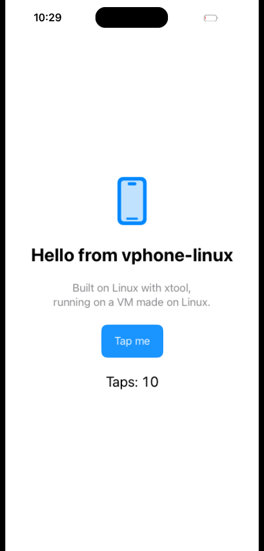

# Setup

You create the virtual iPhone once and run it on your **Linux PC**. It can be created **on Linux
itself, with no Mac** ([CREATE-ON-LINUX.md](CREATE-ON-LINUX.md)), or with vphone-cli on a Mac and
copied over (step 1 below).

1. [What you need](#what-you-need)
2. [Create the VM: on Linux, or on a Mac](#1-create-the-vm-on-linux-or-on-a-mac)
3. [On Linux: install the dependencies](#2-on-linux-install-the-dependencies)
4. [Build](#3-build)
5. [Copy the VM to Linux (Mac route only)](#4-copy-the-vm-to-linux-mac-route-only)
6. [Start it](#5-start-it)
7. [Run your own app](#6-run-your-own-app)
8. [Make it faster (optional)](#7-make-it-faster-optional)

Something not working? See [TROUBLESHOOTING.md](TROUBLESHOOTING.md). Every detail this guide leaves
out (building by hand, the VM's files, the pinned commits) is in [ADVANCED.md](ADVANCED.md).

## What you need

**To create the VM on Linux** (no Mac): root access, about 45 GB more free disk, Swift 6.4.1 and a
few packages. [CREATE-ON-LINUX.md](CREATE-ON-LINUX.md#1-extra-dependencies) lists them.

**Or a Mac, once**, to create the VM there:

- An Apple Silicon Mac (M1 or newer) running macOS 15 or newer. A macOS VM does not work.
- About 100 GB free disk space while creating the VM (firmware and the VM itself).
- An internet connection: the restore fetches signing tickets from Apple.
- vphone-cli's security settings (SIP's research-guest mode), set once from macOS Recovery. See
  [vphone-cli's requirements](https://github.com/Lakr233/vphone-cli#requirements).

**A Linux PC** to run it:

| | Minimum | Recommended |
|---|---|---|
| CPU | x86_64, 8 threads | 8 or more fast cores (speed per core matters most) |
| RAM | 16 GB | 32 GB |
| GPU | A Vulkan GPU | NVIDIA (the only vendor tested so far) |
| Disk | 60 GB free | SSD, 100 GB free |
| OS | Any recent 64-bit distribution | Fedora (the only one tested so far) |

The minimum column is an estimate: vphone-linux was tested on one PC so far (Fedora 44, Intel
i7-14700K, 62 GB RAM, RTX 4080 SUPER). Reports from other hardware are welcome. On a CPU with fewer
than 8 cores, start the VM with fewer virtual CPUs (`SMP=4`). AMD GPUs need
access to `/dev/udmabuf` ([reims-vgpu's notes](https://github.com/steelbrain/reims-vgpu#readme)).
No KVM is needed.

Everything runs under emulation, so expect it to be slower than a real iPhone: apps take a few
seconds to open and scrolling runs at about 60 frames/s with occasional stutters.

## 1. Create the VM: on Linux, or on a Mac

**On Linux**, with no Mac: do steps 2 and 3 below first (dependencies and build), then follow
[CREATE-ON-LINUX.md](CREATE-ON-LINUX.md). It restores Apple's published firmware onto the
open-source OpenAVB/OpenSEP boot ROMs, installs vphone-cli's custom firmware, and leaves a ready VM in
`vms/myphone`; then skip to step 5. It takes about an hour plus the downloads, and several steps
need root.

**On a Mac:** install [vphone-cli](https://github.com/Lakr233/vphone-cli) and create a VM, following its
[create-and-run guide](https://github.com/Lakr233/vphone-cli/blob/main/Documents/Guides/create-and-run.md):

```sh
vphone-cli host preflight
vphone-cli vm create myphone \
  --iphone-source /path/to/iPhone17,3_Restore.ipsw \
  --cloudos-source /path/to/cloudOS.ipsw
```

Tested with vphone-linux: vphone-cli 2.9.4, iPhone17,3 iOS **26.6.2 (23G90)** with cloudOS
**26.4 (23E5207q)**. vphone-cli's [compatibility list](https://github.com/Lakr233/vphone-cli/blob/main/Documents/Guides/compatibility.md)
has the other firmware pairs.

The VM ends up in `~/.vphone/machines/myphone/` on the Mac. Make sure it is stopped
(`vphone-cli vm stop myphone`), and don't run the same copy on the Mac and on Linux.

## 2. On Linux: install the dependencies

On Fedora:

```sh
sudo dnf install git gcc gcc-c++ clang binutils make cmake ninja-build meson python3 rsync \
  glib2-devel pixman-devel lzfse-devel libslirp-devel libssh-devel libzstd-devel \
  nettle-devel gnutls-devel gtk3-devel sdl2-compat-devel bzip2-devel \
  libX11-devel wayland-devel libxkbcommon-devel \
  vulkan-loader vulkan-loader-devel vulkan-tools socat python3-pillow
```

On other distributions, install the same packages under their names there.

Install Rust with [rustup](https://rustup.rs), then set two system options. They are permanent, so
this is needed only once:

```sh
echo vhost_vsock | sudo tee /etc/modules-load.d/vhost-vsock.conf
echo 'KERNEL=="vhost-vsock", MODE="0666"' | sudo tee /etc/udev/rules.d/90-vhost-vsock.rules
sudo modprobe vhost_vsock && sudo chmod 666 /dev/vhost-vsock
echo 'vm.max_map_count = 1048576' | sudo tee /etc/sysctl.d/90-vphone.conf && sudo sysctl --system
```

`vhost_vsock` is how the tools talk to the iPhone; `max_map_count` lets the GPU code map the guest's
memory. Then get the code and check your PC:

```sh
git clone https://github.com/YahiaAngelo/vphone-linux.git
cd vphone-linux
tools/check-host.sh
```

## 3. Build

```sh
./build.sh
```

This downloads the three submodules and builds the GPU library and QEMU. The first build takes a
while (the GPU library is large). Run `./build.sh` again after every `git pull`.

## 4. Copy the VM to Linux (Mac route only)

```sh
tools/import-vm.sh me@my-mac.local:.vphone/machines/myphone myphone
```

This copies the VM from the Mac over ssh into `vms/myphone` (a USB drive path works too) and prepares
it. It also keeps an untouched copy, `vms/myphone.pristine`, to start over from.

## 5. Start it

**NVIDIA only, after every reboot:** lock the GPU clocks. Otherwise the GPU stays at idle speed and
every frame waits for it. These numbers are for an RTX 4080 SUPER; `nvidia-smi -q -d SUPPORTED_CLOCKS`
lists yours.

```sh
sudo nvidia-smi --lock-gpu-clocks=2000,3105 && sudo nvidia-smi --lock-memory-clocks=10000,11501
```

Start the VM:

```sh
GFX=1 WINDOW=1 ./run-vphone.sh vms/myphone
```

A window opens with the iPhone's screen; the terminal shows the boot log. The first boot takes 3-5
minutes to the lock screen. Then unlock it, from a second terminal:

```sh
tools/vphoned.sh POST /v1/rpc '{"method":"screen.unlock","params":{},"id":1}'
```

If it answers "Lock Screen did not dismiss in time", wait 15 seconds and run it again. Swiping up from
the bottom of the screen also works.

**Using it:** click to tap, drag to scroll, swipe up from the bottom edge (or middle-click) to go
Home.

**Stopping it:**

```sh
tools/vphoned.sh POST /v1/rpc '{"method":"system.shutdown","params":{"force":true},"id":1}'
```

or press Ctrl-A then X in the terminal QEMU runs in.

## 6. Run your own app

Build an iOS app on Linux with [xtool](https://github.com/xtool-org/xtool) and run it in the VM. No
Apple ID or signing is needed: vphoned signs the app inside the guest when it installs it.

```sh
xtool new HelloVPhone && cd HelloVPhone
xtool dev build --ipa                     # -> xtool/HelloVPhone.ipa, unsigned
../tools/install-ipa.py xtool/HelloVPhone.ipa --launch com.example.HelloVPhone
```

`xtool setup` installs the Darwin SDK it needs once (it asks for Xcode's `.xip`, which you download
from Apple). On the test PC the sample app built in 9 s, installed in 2 s and opened in the window,
where taps reach it:



## 7. Make it faster (optional)

These made the biggest difference on the test PC:

1. **In the iPhone's Settings:** Accessibility > Motion > **Reduce Motion** on; Accessibility >
   Display & Text Size > **Reduce Transparency** on; Display & Brightness > **Auto-Lock: Never**.
2. **Render at 1x** instead of 3x, about 9 times fewer pixels with the same layout. With the VM
   stopped:

   ```sh
   python3 tools/display-scale.py vms/myphone/nvram.bin 1
   echo 448x932 > vms/myphone/gfx-res
   ```

   Then, with the VM running, restore the boot Apple logo, which iOS has no 1x image for:

   ```sh
   python3 tools/guest-1x-logo.py 3
   ```

   `python3 tools/display-scale.py vms/myphone/nvram.bin 0` and deleting `gfx-res` undo the scale.
3. **Turn off background services** the VM doesn't need for app testing (iCloud, Siri, analytics...).
   vphone-cli's default `vm create` already turns off about 140 of them. More are listed in
   [ADVANCED.md](ADVANCED.md#background-services).

[PERFORMANCE.md](PERFORMANCE.md) explains where the time goes and every tuning switch.
